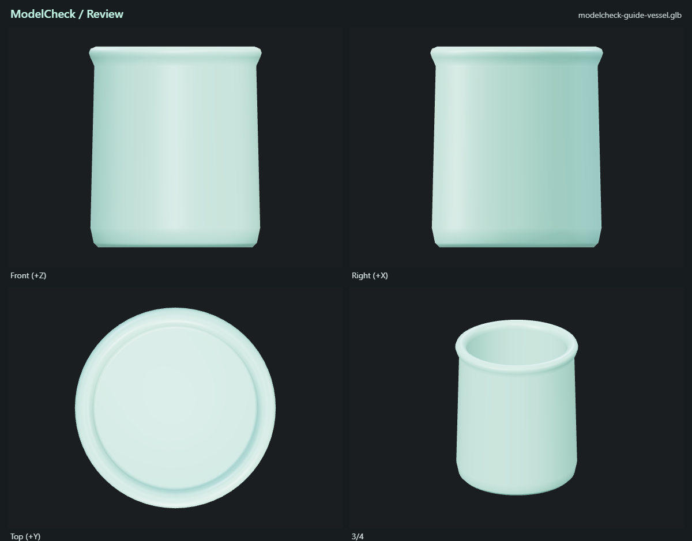

# Build 3D assets with Python

This guide takes you from a brief to a reviewable 3D asset using **Python and a self-contained GLB**. The examples generate geometry, materials and scene structure with the Python standard library. The entire workflow runs without Blender. ModelCheck renders the result so a coding agent can inspect it, revise the generator and share the finished asset.

## Turn the brief into parameters

Translate the brief into the geometry the viewer should recognize. Identify the **silhouette, proportions, contact points, openings and moving parts** that define the asset. Give exact requirements named parameters. For a display stand, that might be **1.6 m wide, 1.2 m high and 0.8 m deep**, centered on **X** and **Z**, with its base on **Y = 0**. Derive post positions from the platform width so a revision keeps the design coherent.

For a visual brief, start with what should read from the target camera. A close-up handheld prop may need a shaped grip, seams and varied roughness. An asset viewed at a distance benefits more from a recognizable outline and distinct groups of materials. Use the available references to make those choices. Treat approximate dimensions, style and construction details as design decisions when the brief leaves them open.

Pick a few outcomes you can verify. For a **small pump with a carry handle**, they might be a recognizable body and outlet in the ¾ view, a clear opening beneath the handle from the front, and four feet sitting on the same plane. A curve sweep might be a good fit for the handle while a revolved profile might suit the outlet. You could also model the body and handle as a continuous shell if that better matches the reference. Where the shape is uncertain, render a quick blockout or compare two silhouettes before spending time on surface details.

## Choose geometry that fits the shape

| Shape or requirement | Python approaches to consider |
| --- | --- |
| An assembly with distinct parts | Place named primitives or chamfered meshes with transforms. Reuse geometry for repeated parts such as wheels, posts or fasteners. Keep parts separate where materials, pivots or later edits benefit. |
| A cylindrical, turned or hollow form | Revolve a radius–height profile. Encode the lip, inner wall and base in the section so they remain visible from above and at an oblique angle. |
| A handle, cable or organic silhouette | Sweep a section along a curve or loft between sections. Add samples where curvature changes. Check the frame orientation so the section stays stable through bends. |
| Mechanical openings or precise joins | Construct the surrounding surfaces explicitly, or use a Python solid-modeling or mesh boolean library when that makes intersections easier to control. Check narrow walls and the output mesh after tessellation. |
| A textured or animated asset | Use an exporter that supports the properties you need. Author UVs for image textures, meaningful pivots for moving rigid parts, or joints and weights for skinning. Check the exported result in a viewer that supports playback if motion is part of the brief. |

Combine approaches freely and replace the sample writer if another Python exporter fits the asset better. A library such as **Trimesh** is useful when you want mesh operations or a scene exporter. For a new export path, try a representative part first and check that it preserves what matters to the final asset, such as per-face material assignments, UVs, named nodes, or a moving part's pivot. [Trimesh glTF exporter](https://trimesh.org/trimesh.exchange.gltf.html)

### Add detail that reads in the render

- **Silhouette and construction.** Check the main forms at the intended viewing size. Add thickness at exposed edges and believable transitions where parts meet. Place bevels where they will catch light, especially around the rim of an opening or the edge of a large flat surface.
- **Shading and materials.** Match normals to the shape. Smooth a curved span and give intentional creases their own normals. Use roughness, metalness and color to distinguish materials at the same lighting angle. Check the highlights in the rendered GLB.
- **Export and scale.** Keep the origin useful for placement or animation. glTF uses **+Y up, +Z forward, and meters**. Keep scale and origin consistent across revisions. Embed buffers and textures in the GLB, and use compatible UV and material data if the brief calls for textures. [glTF coordinate system and units](https://registry.khronos.org/glTF/specs/2.0/glTF-2.0.html#coordinate-system-and-units)

## Review what the GLB actually contains

With the [ModelCheck setup](README.md#quick-start) in place, render a sheet of the exported asset:

```sh
npm run --silent inspect -- review/model.glb --out review/model.png
```

Open the **`png`** path from stdout with your image tool. Read the **`report`** path for bounds, counts and animation names. In a ¾ view, check how the main forms read together. Use the front, right and top views for symmetry, clearance or alignment. For details that need more pixels, render a single view such as **`--view right --size 1600`** or orbit and zoom in the browser.

| What you observe | Where to look in the generator |
| --- | --- |
| The handle opening disappears from the front | Check the sweep section, attachment positions and the clearance measured between the actual surfaces. |
| The lip has flat spots or a crease catches too much light | Check sampling around the curve, normal continuity and the bevel profile. |
| A face disappears when viewed from one side | Check triangle winding and the intended sidedness. For a shell with visible thickness, inspect the inner and outer walls separately. |
| The GLB has the right dimensions but sits unevenly | Check part transforms and world-space contact heights. Overall bounds alone cannot establish that all feet touch the floor. |
| An animated part rotates around the wrong spot | Check the pivot node, child offsets and keyframes. Play the exported clip and inspect the pose where the defect shows. |

Use geometry checks when the brief calls for them. For a printable shell, check watertightness, self-intersections and minimum wall thickness. For a game prop, prioritize the triangle and texture budgets and check that the expected UVs, materials and pivots survive export. For motion, review the relevant poses, clearances and loop transition.

Fix the source, export a distinct revision, and verify the change in the GLB. Keep the **Python source**, **final GLB** and **review image** together so the next person or agent can reproduce the result. Share the interactive viewer when the reviewer needs to explore it from additional angles. [Agent review workflow](AGENTS.md#send-the-user-a-review-link)

## Build a parametric stand

After following the setup in the [README](README.md), run this from the repository root:

```sh
python examples/generate_stand.py --width 1.6 --height 1.2 --depth 0.8 --revision v1 --out review/stand-v1.glb
npm run --silent inspect -- review/stand-v1.glb --out review/stand-v1.png
```

[The generator](examples/generate_stand.py) uses **`make_stand(width, height, depth)`** to define four parts. The base is centered at half its thickness on Y, so the bottom is at zero. The platform's upper face is at **`height`**. Both posts are derived from those dimensions and remain symmetric when the stand changes width.

1. Open the **`png`** path from stdout with the agent's image tool. Check that the base and platform span the posts, that the posts are mirrored, and that there are no visible gaps.
2. Open the **`report`** path. Check **`model.bounds.size`** against **`[1.6, 1.2, 0.8]`** in XYZ order, allowing a small floating-point tolerance. Check that **`model.bounds.min[1]`** is near zero.
3. When the brief changes, regenerate into a distinct file. Suppose the stand now needs to be **2.0 m wide**. Export the revised model and compare it with the previous one.

```sh
python examples/generate_stand.py --width 2.0 --height 1.2 --depth 0.8 --revision v2 --out review/stand-v2.glb
npm run --silent inspect -- review/stand-v2.glb --baseline review/stand-v1.glb --view front --out review/stand-comparison.png
```

Check that the revised stand is wider and remains centered in the PNG. Expect **`delta.bounds.size[0]`** to be near **+0.4**, with no change to height, depth, or triangle count. Keep the generator, the final GLB, and a review image for the handoff.

## Record which model the versions belong to

Choose a stable **`assetId`** once per logical asset and keep it in the generator. Change **`revision`** with each meaningful export. If you're editing a generator that already has an ID, carry it forward. For the stand example, both files use **`modelcheck:stand`**, and the commands above label the outputs **`v1`** and **`v2`**.

The sample writer can attach these fields directly. Use your own project prefix and asset name.

```python
model = Model(asset_id="my-project:display-stand", revision="v2")
```

In the GLB JSON chunk, the fields live under **`asset.extras.modelcheck`**. The comparison still takes an explicit **baseline**. Read **`identityStatus`** from its JSON and check **`baseline.identity`** and **`model.identity`**:

| Status | What to do |
| --- | --- |
| **`matching-id`** | Confirm the revision labels and inspect the intended change. |
| **`different-ids`** | Confirm that comparing these two assets is intentional. |
| **`unrecorded`** | Confirm the baseline and current file from the brief or generator history. |

These are labels written by the exporter. Keep the baseline GLB and source revision if you need to reproduce a review later.

## Run the dependency-free example

Run these commands from the ModelCheck root, after installing the Node dependencies and browser listed in the [README](README.md). The generator uses the Python standard library.

```sh
python examples/generate_rover.py --raised-wheel --out review/rover-before.glb
python examples/generate_rover.py --out review/rover-after.glb
npm run --silent inspect -- review/rover-after.glb --baseline review/rover-before.glb --view right --out review/rover-comparison.png
```

In the **Right (+X)** comparison, the rear-right tire on the baseline is higher because **`make_rover()`** sets its center to **`y = .59`**. The revised version puts all four centers at **`y = .43`**. The two versions have identical overall bounds and mesh counts. Use the image to verify the wheel alignment.

### Change the example

- **`block()`** builds a solid chamfered box. Edit the body dimensions or add a part with a name, dimensions, position, and material index.
- **`prism()`** builds a capped cylinder along the X axis. The rover uses it for tires, rims, and hubs.
- **`PALETTE`** sets linear RGBA base colors, metallic factors, and roughness.
- **`Model.write()`** packs indexed triangle geometry, normals, transforms, and materials into a single GLB. Mesh coordinates follow glTF's Y-up convention. This rover treats +Z as its front.

### Give a rigid part a pivot and two motion clips

```sh
python examples/generate_rover.py --animate --out review/rover-motion.glb
npm run dev
```

In **`animate_sensor()`**, the housing, face and lenses become children of a **pivot node** at the sensor mount. Their translations are converted to offsets from the pivot. Both clips rotate that node, so the pieces stay aligned as a group. The Python writer stores keyframe times in seconds and rotations as unit quaternions. The two clips share timings and use different rotation axes. A skinned character, morphing surface or articulated chain may call for a different Python exporter and scene structure.

Open the exported GLB in ModelCheck and choose **Sensor sweep**. Scrub to about **0.70 s** and **1.45 s** to inspect both extremes. Check that the housing turns around the mount, the lenses follow it, and the chassis remains still. Choose **Sensor tilt** to check clearance from the deck. **Save current view** captures the pose for an agent's image tool. Use **Rest pose** to return to the original assembly.

## Build a hollow vessel from a profile

This example makes a ceramic vessel with a slightly tapered wall, rounded lip and recessed interior. The **profile** gives you control over those features. Change the radii and heights to explore other silhouettes, or add a handle as a separate swept mesh. This version of the helper expects an ordered profile with a pole at each end and positive radii between them.

Save the Python below as **`make_vessel.py`** at the repository root. It uses the same standard-library writer as the rover.

```python
import math
import sys
from pathlib import Path

from examples.generate_rover import Model


def revolve(profile, segments=64):
    """Rotate a (radius, Y) section about the Y axis."""
    positions, normals, indices, rings = [], [], [], []
    angles = [math.tau * i / segments for i in range(segments)]

    for index, (radius, height) in enumerate(profile):
        if radius == 0:
            # One vertex at each pole avoids a ring of coincident vertices.
            rings.append([len(positions)] * segments)
            positions.append((0, height, 0))
            normals.append((0, -1 if index == 0 else 1, 0))
            continue

        previous_radius, previous_height = profile[index - 1]
        next_radius, next_height = profile[index + 1]
        dr = next_radius - previous_radius
        dy = next_height - previous_height
        length = math.hypot(dr, dy)
        ring = []
        for angle in angles:
            c, s = math.cos(angle), math.sin(angle)
            ring.append(len(positions))
            positions.append((radius * c, height, radius * s))
            normals.append((dy * c / length, -dr / length, dy * s / length))
        rings.append(ring)

    for current, following in zip(rings, rings[1:]):
        for i in range(segments):
            j = (i + 1) % segments
            if current[i] != current[j]:
                indices.extend((current[i], following[i], current[j]))
            if following[i] != following[j]:
                indices.extend((current[j], following[i], following[j]))
    return positions, normals, indices


# Travel from the underside, up the outer wall, and down the inner wall.
section = [
    (0, 0), (.099, 0), (.105, .006), (.109, .025),
    (.104, .233), (.109, .244), (.111, .250), (.109, .255),
    (.102, .258), (.096, .256), (.092, .251), (.091, .244),
    (.092, .033), (.087, .020), (0, .020),
]
model = Model(asset_id="my-project:vessel", revision="v1")
model.part("Ceramic vessel", revolve(section), (0, 0, 0), material=0)
model.write(Path(sys.argv[1] if len(sys.argv) > 1 else "review/vessel.glb"))
```

```sh
python make_vessel.py review/vessel.glb
npm run --silent inspect -- review/vessel.glb --out review/vessel.png
```

In the **top and ¾ views**, check that the rim is continuous and the inner wall is visible. In the **front view**, look for a flat base and a smooth transition into the lip. The bounds should be approximately **0.222 × 0.258 × 0.222 m** in XYZ order. If a wall appears missing, inspect triangle winding and normals from inside the opening. For a close-up version, choose the profile and angular sampling based on the silhouette and highlights. The example writer uses 16-bit indices per primitive. An exporter with 32-bit indices or a sensible split into multiple primitives can accommodate larger meshes.


