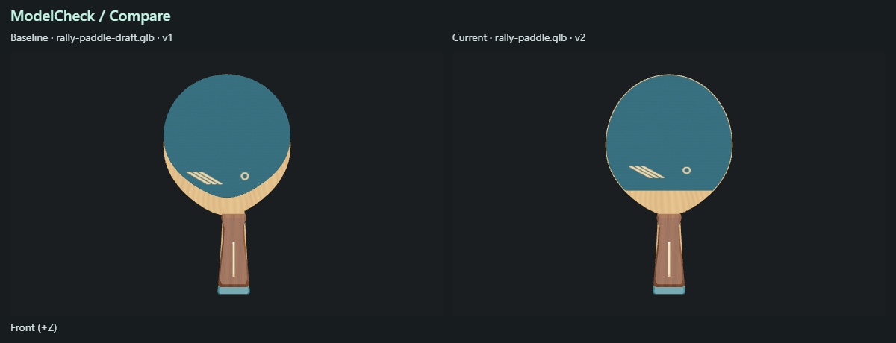

<div align="center">
  <h1>ModelCheck</h1>
  <p><strong>Give your coding agent a 3D brief. Get a GLB it has actually inspected.</strong></p>
  <p>Generate in Python · Review the render · Revise the asset</p>
  <p>
    
    
    <a href="LICENSE"></a>
  </p>
  <p>
    <strong>English</strong> · <a href="README.tr.md">Türkçe</a> · <a href="https://hakanbabus.github.io/ModelCheck/?sample=rally-paddle">Live example</a> · <a href="PYTHON_MODEL_GUIDE.md">Python guide</a>
  </p>
  <a href="docs/rally-comparison.png"></a>
  <p><sub>Rally, generated in Python. The same front view makes the shifted grip and the revised rubber fit easy to compare.</sub></p>
</div>

## Ask your agent

> Use [ModelCheck](https://github.com/HakanBabus/ModelCheck) to make a detailed table-tennis paddle. Generate it in Python, open the inspection images, critique the result, fix what you find, and give me the final GLB and source.

The agent can use a local checkout or clone the repository and start with **[AGENTS.md](AGENTS.md)**. The guide leads it through generation, critical visual review, revision and handoff. ModelCheck's job is to turn the resulting GLB into evidence the agent can inspect. The agent chooses how to create the asset. [Blender-free Python guide](PYTHON_MODEL_GUIDE.md) · [Worked Rally example](docs/DETAILED_ASSET_EXAMPLE.md)

## Quick start

Run with **Node.js 22.12+** and **Python 3** for the example generator.

```sh
git clone --depth 1 https://github.com/HakanBabus/ModelCheck.git
cd ModelCheck
npm ci
python examples/generate_paddle.py --out review/rally-paddle.glb
npm run --silent inspect -- review/rally-paddle.glb --out review/rally.png
```

The command prints absolute **`png`** and **`report`** paths as JSON. Open the PNG and check the report for bounds and geometry counts. For focused checks, choose **`--view back`**, **`--view bottom`** or another angle. Add **`--baseline <previous.glb>`** to compare revisions in shared coordinates. Use **`--help`** for all options.

Inspection runs locally using Playwright Chromium, Chrome or Edge. To install Chromium, run **`npx playwright install chromium`**. On Linux, use **`npx playwright install --with-deps chromium`** if system browser libraries are missing.

## Browser viewer

Open a self-contained GLB or a folder of models. Use **Auto orbit**, **Fly**, **Measure**, **Section**, **Motion** or **Pin** to inspect it. **Compare versions** uses shared coordinates so shifts in scale and origin stay visible. The exporter can tag a stable asset ID and a distinct revision for easier pairing. [Live example](https://hakanbabus.github.io/ModelCheck/?sample=rally-paddle) · [Revision metadata](PYTHON_MODEL_GUIDE.md#record-which-model-the-versions-belong-to)

**Save current view** captures the active cut or pose. Review sheets and comparisons show the full model in its rest pose. Use **`npm run dev`** to start the viewer locally and **`npm run build`** to export the static site into **`dist/`**.

## Share an interactive review

```sh
npm run --silent share -- review/rally-paddle.glb --title "Rally review"
```

The returned **`url`** opens the GLB on the same computer. The server closes after one idle hour. Add **`--baseline`** to include a comparison or **`--pins`** to include saved notes. For access from another device, use **`--static`** and publish the generated **`directory`** to a host reachable by the reviewer. The directory includes the selected GLBs.

<details>
<summary>Browser API and development</summary>

Open the viewer with **`?automation`** to skip the sample. **`window.modelCheck.open(file)`** accepts a browser **`File`**. **`report()`** returns the active report, **`capture({view, size})`** returns a PNG Blob, and **`compare(baselineFile, {view, size})`** returns the PNG and comparison metadata. Browser automation can also set **`#files`** and wait for **`#state[data-phase="ready"]`** or read **`#stage-message`** on error.

Run **`npm run build`** and **`npm test`** for browser and CLI coverage. Set **`MODELCHECK_BROWSER=msedge`** to select Edge explicitly.

</details>

[MIT license](LICENSE)
