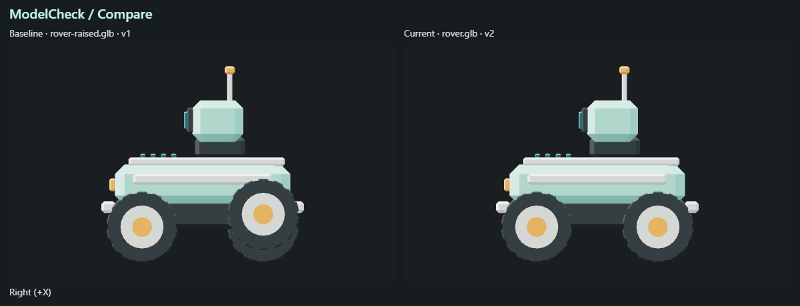

<div align="center">
  <h1>ModelCheck</h1>
  <p><strong>Review generated 3D models, from the browser or the terminal.</strong></p>
  <p>Open a GLB, render it from four angles, and compare two revisions in the same frame.</p>
  <p>
    
    
    <a href="#quick-start"></a>
    <a href="LICENSE"></a>
  </p>
  <p>
    <strong>English</strong> · <a href="README.tr.md">Türkçe</a>
    <br>
    <a href="#quick-start">Quick start</a> · <a href="#agent-workflow">Agent workflow</a> · <a href="PYTHON_MODEL_GUIDE.md">Python guide</a>
  </p>
  <a href="docs/rover-comparison.png"></a>
  <p><sub>The baseline on the left has a raised rear wheel. The triangle count and overall bounds match. The shared side view shows the fix.</sub></p>
</div>

## One viewer, two ways to use it

| In the browser | From the terminal |
| --- | --- |
| Open a GLB or browse a folder of models. Orbit, zoom, switch views, and inspect counts and bounds. | Give a coding agent a GLB path. The CLI returns a PNG for its image tool and JSON for its checks. |
| Choose **Compare versions** to place a baseline and the current model side by side. | Pass **`--baseline`** to render the same comparison headlessly. |

Comparisons frame both models in **shared GLB coordinates**. Changes in scale and placement stay visible. The viewer reads self-contained **GLB 2.0** files locally and previews animated models in their initial pose.

## Quick start

Run the following commands from the repository root with **Node.js 22.12+** installed. The viewer uses **WebGL 2**.

```sh
npm ci
npm run dev
```

Open the URL printed by Vite. The sample rover loads automatically. Choose **Compare versions → Right** to see the wheel alignment, or use **Open GLB** or **Open folder** for your own files. [See the workspace](docs/workspace.png)

## Agent workflow

Generate a GLB from Python, render it, and have the agent open the PNG with its image tool. After revising the generator, render the new GLB alongside the baseline and inspect the result.

```sh
npx playwright install chromium
npm run --silent inspect -- public/rover.glb --baseline public/rover-raised.glb --view right --out review/rover-comparison.png
```

The command prints the absolute **`png`** and **`report`** paths as JSON. The report records geometry counts, bounds, and hashes. With a baseline, it also records **current minus baseline** deltas. Rendering runs locally and requires no API key.

| Option | What it controls |
| --- | --- |
| **`--baseline <file.glb>`** | Compare with an earlier version. Leave it out to inspect one GLB. |
| **`--view <view>`** | Choose `sheet` (four views), `front`, `right`, `top`, or `iso`. |
| **`--size <px>`** | Set the PNG width from 480 to 2400 pixels. |
| **`--out <file.png>`** / **`--report <file.json>`** | Set output paths. The JSON defaults to the PNG path with a `.json` extension. |

On Linux, use `npx playwright install --with-deps chromium` if browser system libraries are missing. Use **`--browser msedge`** to run with an existing Edge installation.

## Learn and build

- [**Python model guide**](PYTHON_MODEL_GUIDE.md) — Turn dimensions into a parametric stand, export it, and verify a revision with the image and report. Includes a Blender Python export example.
- [**Agent instructions**](AGENTS.md) — Use the CLI or browser API in a coding agent's generate, inspect, and revise loop.

```sh
npm run build
npm test
npm run preview
```

The production build is in **`dist/`**. Smoke tests cover file loading, capture downloads, and PNG parity between the browser and the CLI. To test with Edge, set **`MODELCHECK_BROWSER=msedge`**. To host the static viewer with GitHub Pages, set **Settings → Pages → Source** to **GitHub Actions** and run **Deploy demo to Pages**.

[MIT license](LICENSE)
