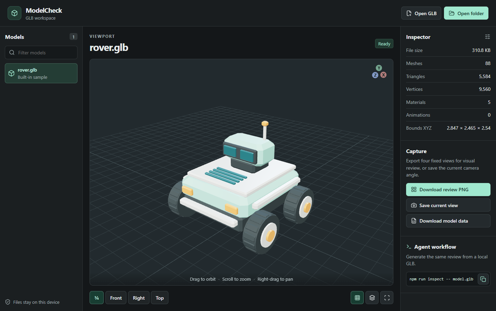
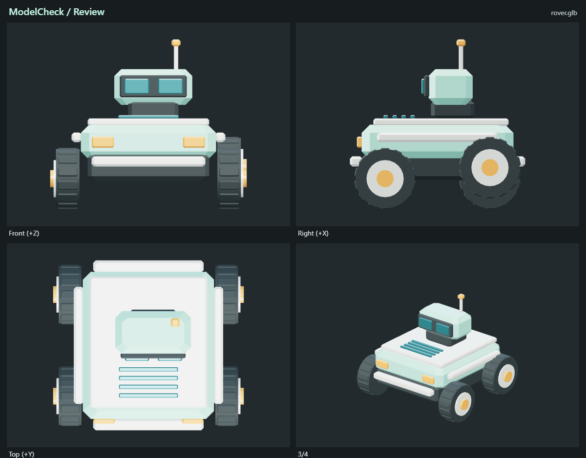
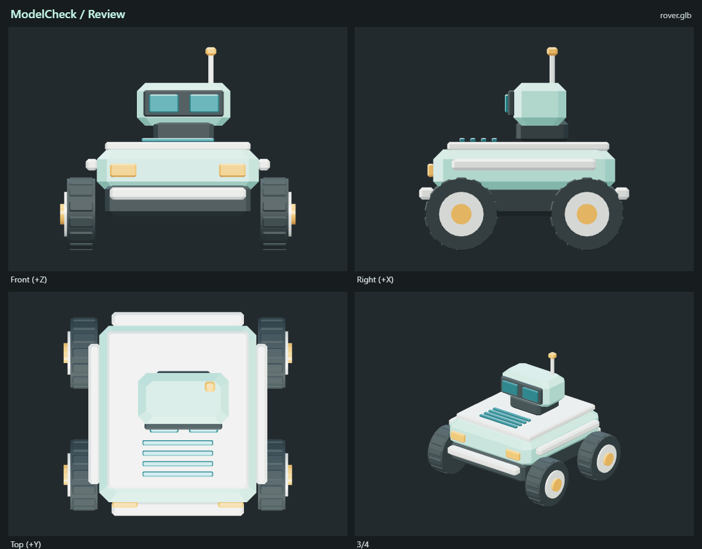

# ModelCheck

Open local GLB files in your browser. Give coding agents a command that renders the same model into an image they can inspect.



## Open a model

Requirements: **Node.js 22.12+** and a browser with **WebGL 2**. Python is optional for generating the example.

```sh
npm ci
npm run dev
```

Open the local URL printed by Vite. The workspace starts with an original rover. Use **Open GLB**, drop files onto the viewport, or use **Open folder** to list GLBs in a directory and its subdirectories. Filter by name or relative path. Use the camera presets, orbit, pan, zoom, grid, and wireframe to inspect a model. The Inspector reports file size, geometry counts, materials, animation clips, and bounds in the source model's units.

**Download review PNG** captures fixed front, right, top and three-quarter views. **Save current view** captures your current view and display toggles. **Download model data** saves the Inspector's values as JSON.

The browser reads selected files locally. Use **self-contained GLB 2.0** files with embedded textures and buffers. The app previews the initial pose of animated models and reports their clip names and durations.

## Use it from an agent

```sh
npm ci
npx playwright install chromium
npm run inspect -- public/rover.glb --out review/rover.png
```

On Linux, use `npx playwright install --with-deps chromium` when browser system libraries are needed. If you already have Edge installed, append `--browser msedge` to the inspect command.

The command opens the viewer in headless Chromium, renders the same review sheet, and writes **PNG** and **JSON** files. It works with local file paths and needs no API key. The JSON includes the original model's bounds, geometry counts, and SHA-256 hashes for the GLB and PNG. With `npm run --silent inspect`, stdout is a single JSON object containing the two absolute output paths. The command exits with a nonzero code when it fails.

```sh
npm run --silent inspect -- "models/rover v2.glb" --view right --size 1000 --out review/right.png
```

Use **`--view`** with `sheet`, `front`, `right`, `top`, or `iso`. Use **`--size`** for the PNG width (480–2400) and **`--report`** for a custom JSON path. A browser agent can also open the page, select a GLB, and click the capture button. For scripted browser integrations, see [AGENTS.md](AGENTS.md).

## Example inspection

The Python example can generate a rover with its rear-right wheel raised. In the **Right (+X)** panel, the rear wheel is visibly above the front wheel. Generating the aligned version and rerendering puts the two wheel hubs at the same height.

| Raised wheel | Aligned wheels |
| --- | --- |
| [](docs/rover-before.png) | [](docs/rover-after.png) |

The exercise uses the same loop an agent follows on real assets. **Generate → render → read the PNG → edit → regenerate.** Start with [the Python guide](PYTHON_MODEL_GUIDE.md).

## Build and verify

```sh
npm run build
npm test
npm run preview
```

The static site is generated in **`dist/`**. The browser smoke test uses the production build and verifies folder selection, downloads, mobile layout, and that the CLI and browser return identical review PNGs for the sample in the same browser environment. To run the smoke test with an installed Edge browser, set **`MODELCHECK_BROWSER=msedge`**.

To host on GitHub Pages, set **Settings → Pages → Source** to **GitHub Actions**, then run **Deploy demo to Pages** from the Actions tab. The web viewer runs on the static site. The headless command runs from a checkout with Node and Chromium.
