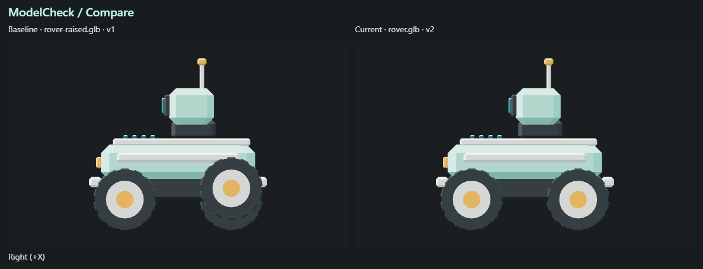

<div align="center">
  <h1>ModelCheck</h1>
  <p><strong>Ürettiğin 3B modelleri tarayıcıdan veya terminalden incele.</strong></p>
  <p>GLB dosyasını aç, dört açıdan görüntü al ve iki sürümü aynı kadrajda karşılaştır.</p>
  <p>
    
    
    <a href="#hızlı-başlangıç"></a>
    <a href="LICENSE"></a>
  </p>
  <p>
    <a href="README.md">English</a> · <strong>Türkçe</strong>
    <br>
    <a href="#hızlı-başlangıç">Hızlı başlangıç</a> · <a href="#ajan-akışı">Ajan akışı</a> · <a href="PYTHON_MODEL_GUIDE.md">Python rehberi</a>
  </p>
  <a href="docs/rover-comparison.png"></a>
  <p><sub>Soldaki modelin arka tekerleği yüksekte. Üçgen sayısı ve dış boyutlar aynı. Ortak yan görünüş düzeltmeyi gösteriyor.</sub></p>
</div>

## Tek görüntüleyici, iki kullanım yolu

| Tarayıcıda | Terminalde |
| --- | --- |
| Bir GLB aç veya klasördeki modellere göz at. Modeli döndür, yakınlaştır ve ölçülerine bak. | Kodlama ajanına GLB yolunu ver. Komut, ajanın bakabileceği bir PNG ve okuyabileceği bir JSON üretir. |
| **Compare versions** ile referans modeli ve yeni sürümü yan yana koy. | **`--baseline`** ile aynı karşılaştırmayı tarayıcı penceresi açmadan al. |

İki model **aynı GLB koordinatları ve ölçekle** çizilir. Boyut ve konum farkları görüntüde kalır. Görüntüleyici, dokuları ve tamponları gömülü **GLB 2.0** dosyalarını yerelde okur. Animasyonlu modeller başlangıç pozunda gösterilir.

## Hızlı başlangıç

**Node.js 22.12+** ve **WebGL 2** destekli bir tarayıcı gerekir. Başlatmak için aşağıdaki komutları proje klasöründe çalıştır.

```sh
npm ci
npm run dev
```

Vite’ın yazdırdığı adresi aç. Örnek araç hazır yüklenir. Tekerlek hizasını görmek için **Compare versions → Right** seç. Kendi dosyaların için **Open GLB** veya **Open folder** kullan. [Çalışma ekranına bak](docs/workspace.png)

**Auto orbit** kamerayı modelin çevresinde döndürür. Büyük sahnelerde **Fly** ile gez. Bakmak için sürükle, ilerlemek için **WASD**, alçalmak ve yükselmek için **Q/E**, hızlanmak için **Shift** kullan. **Esc** yörünge moduna döndürür. Dokunmatik ekranda yön düğmeleri görünür.

Bir parçaya çift tıklayarak dönüş merkezini oraya al. **Measure** ile seçtiğin iki noktanın doğrusal uzaklığını modelin orijinal birimiyle ölç.

## Ajan akışı

Ajan Python ile GLB üretir, görüntüyü alır ve kendi görsel okuma aracıyla PNG’yi inceler. Python kodunu değiştirdikten sonra yeni sürümü referans modelle yan yana render edip sonucu kontrol eder.

```sh
npx playwright install chromium
npm run --silent inspect -- public/rover.glb --baseline public/rover-raised.glb --view right --out review/rover-comparison.png
```

Komut, **`png`** ve **`report`** dosyalarının tam yollarını JSON olarak yazdırır. Raporda geometri sayımları, sınır ölçüleri ve dosya özetleri bulunur. Referans model verildiğinde farklar **yeni sürüm eksi referans** olarak hesaplanır. Render yerelde çalışır ve API anahtarı gerektirmez.

Karşılaştırma ekranı, üreticinin yazdığı **model kimliklerinin** eşleştiğini, farklı olduğunu ya da bulunmadığını gösterir. Karşılaştırılacak referansı sen veya ajan seçer. [Sürüm etiketleme rehberi](PYTHON_MODEL_GUIDE.md#record-which-model-the-versions-belong-to)

| Parametre | Ne işe yarar? |
| --- | --- |
| **`--baseline <dosya.glb>`** | Önceki sürümle karşılaştırır. Parametreyi çıkarırsan tek modeli inceler. |
| **`--view <açı>`** | `sheet` (dört açı), `front`, `right`, `top` veya `iso` görünümünü seçer. |
| **`--size <px>`** | PNG genişliğini 480–2400 piksel arasında ayarlar. |
| **`--out <dosya.png>`** / **`--report <dosya.json>`** | Çıktı yollarını belirler. JSON, varsayılan olarak PNG dosyasının adını `.json` uzantısıyla alır. |

Linux’ta tarayıcı sistem kütüphaneleri eksikse `npx playwright install --with-deps chromium` çalıştır. Kurulu Edge’i kullanmak için **`--browser msedge`** ekle.

## İnceleme bağlantısı paylaş

Ajan çıktısını kontrol ettikten sonra etkileşimli bir inceleme bağlantısı hazırlayabilir. Kullanıcı bağlantıyı açtığında güncel modeli, varsa referans sürümü ve kısa notu görür.

```sh
npm run --silent share -- public/rover.glb --baseline public/rover-raised.glb --title "Keşif aracı" --note "Sağ görünüşten arka tekerleği kontrol et."
```

JSON’daki **`url`** aynı bilgisayarda açılır. Sunucu bir saat kullanılmadığında kapanır. Başka cihazlardan açılacak bir adres için **`--static`** ile oluşturulan **`directory`** klasörünü statik bir sunucuda yayınla ve o adresi paylaş. Klasör seçilen GLB’lerin kopyalarını içerir.

## Rehberler ve geliştirme

- [**Python model rehberi**](PYTHON_MODEL_GUIDE.md) — Blender kullanmadan Python ile GLB üret. Çalıştırılabilir örneklerle modele uygun yöntemleri seç, çıktıdaki sorunları bul ve kaynak kodda düzelt.
- [**Ajan talimatları**](AGENTS.md) — Model üretme, inceleme ve düzeltme döngüsünde CLI’ı veya tarayıcı API’sini kullan.

```sh
npm run build
npm test
npm run preview
```

Üretim derlemesi **`dist/`** klasörüne yazılır. Testler dosya açmayı, indirmeleri ve tarayıcı ile CLI’ın aynı PNG’yi üretmesini kontrol eder. Edge ile test etmek için **`MODELCHECK_BROWSER=msedge`** ayarla. Statik görüntüleyiciyi GitHub Pages’te barındırmak için **Settings → Pages → Source** alanını **GitHub Actions** olarak ayarla ve **Deploy demo to Pages** akışını çalıştır.

[MIT lisansı](LICENSE)
