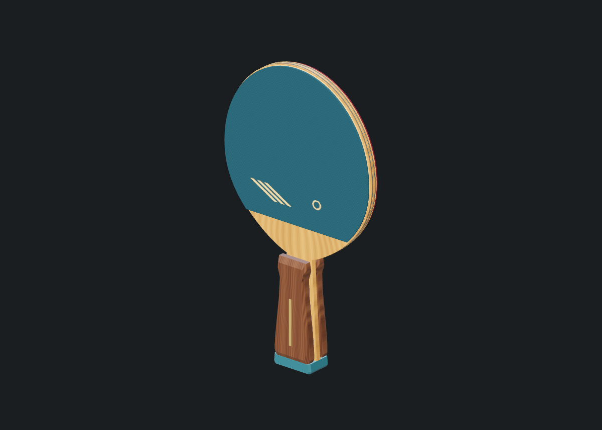

# Make and review a detailed asset

> Use ModelCheck to make a detailed table-tennis paddle. Generate it in Python, inspect the renders, fix what you find, and give me the finished asset.

**Rally** is an original paddle with laminated wood, textured rubber faces, separate sponge layers and a flared grip. Its GLB embeds the textures. The origin is in the grip and the blade extends along **+Y**. The example shows how a layered prop can benefit from both geometry and textures. Other shapes may call for entirely different methods.

## Generate, critique and revise

Use **Python 3** and **Node.js 22.12+**. The generator uses the Python standard library. Run from the ModelCheck checkout.

```sh
npm ci
python examples/generate_paddle.py --draft --out review/rally-draft.glb
npm run --silent inspect -- review/rally-draft.glb --out review/rally-draft.png
```

Open the returned **`png`**. The draft grip is **8 mm** to the right of the blade centerline. The front view exposes it even though the blade defines the full width. The ¾ view also shows how the rounded rubber edge exposes a widening strip of veneer toward the throat. For the intended finish, the rubber should track the blade perimeter and end cleanly above the grip.

The example generator exposes the two defects through **`--draft`**. In your own job, fix them in source and inspect the new GLB.

```sh
python examples/generate_paddle.py --out review/rally-paddle.glb
npm run --silent inspect -- review/rally-paddle.glb --baseline review/rally-draft.glb --view front --out review/rally-comparison.png
npm run --silent inspect -- review/rally-paddle.glb --view iso --size 1600 --out review/rally-detail.png
npm run --silent inspect -- review/rally-paddle.glb --view back --out review/rally-back.png
```

In the **front comparison**, verify that the grip and blade share a centerline and the rubber follows the rim. In the **¾ detail**, inspect the veneer and sponge thickness, the walnut grip bevels and the brass inlays. Open the **back** and **bottom** views for the red rubber and the butt cap. Check the finished shape at the viewing distance that matters to the brief. [Inspect both versions in the live viewer](https://hakanbabus.github.io/ModelCheck/?sample=rally-paddle)

## Read the generator and hand off

**`polygon_slab()`** builds closed surfaces with bevels and planar UVs. **`make_paddle()`** assembles seven plies, separate sponge and rubber faces, and the grip. A normal map supplies fine rubber detail. The wood grain also varies roughness. Finite thickness comes from geometry, so it reads from the side as well as the front.



Hand over the **final GLB**, any target-project path where it belongs, and the review image with a concise account of changes. Keep **`generate_paddle.py`** and its **`generate_rover.py`** writer together for a reproducible source handoff. If there is a target application, check the imported asset there when you can.
